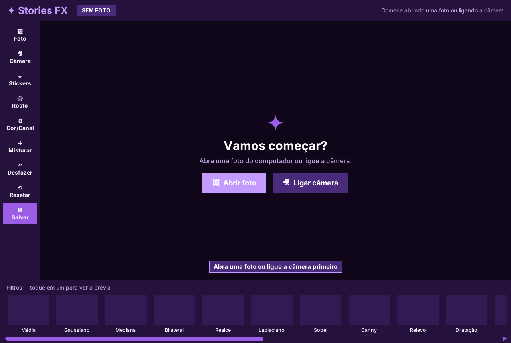

# Stories FX: Efeitos em Imagens e Vídeo (Trabalho Prático - Grau B)

**Aluna:** Lorrana Lasch (Trabalho Individual)  
**Disciplina:** Processamento Gráfico: Fundamentos  
**Curso:** Ciência da Computação — Unisinos  

---

## Sobre o Trabalho

Protótipo de um aplicativo de edição de imagens e vídeo inspirado nos *stories* do Instagram, desenvolvido em **Python** com **OpenCV**. Há três interfaces que usam o mesmo código de processamento:

* **`main.py` (principal)**: abre o app em **uma janela só**, no estilo de aplicativo de stories, em **Tkinter** com tema roxo (código em `app.py`). Imagem grande no centro, faixa de filtros com miniaturas de prévia e ícones grandes; as opções avançadas ficam em gavetas que só abrem quando precisa.
* **`gui.py`** (alternativa): painel completo em Tkinter, com menus e todos os controles visíveis ao mesmo tempo.
* **`highgui.py`** (alternativa): versão em HighGUI do OpenCV + teclado/console, com duas janelas (imagem e controles).

O app funciona em dois modos:

1. **Modo Foto:** carrega uma imagem do disco.
2. **Modo Vídeo:** captura a webcam em tempo real (iniciar/parar com uma tecla).

Nos dois modos é possível aplicar **filtros**, escolher o **canal** processado, fazer **operações aritméticas com uma segunda imagem**, colocar **stickers** com o mouse, **salvar** o resultado e **resetar** tudo para a imagem original.




---

## Como Executar

Requisitos: **Python 3.9+** e uma webcam (só para o Modo Vídeo).

Dentro da pasta `src/TrabalhoPraticoGB`:

```bash
# (opcional) criar um ambiente virtual
python -m venv .venv
# Windows: .venv\Scripts\activate    |    Linux/macOS: source .venv/bin/activate

pip install -r requirements.txt

python main.py                     # abre o app (uma janela só)
python main.py caminho/da/foto.jpg # já abre com uma foto

# alternativas opcionais
python gui.py                      # painel completo (Tkinter)
python highgui.py                  # versão HighGUI + teclado
```

> O Tkinter já vem com o Python no Windows e no macOS. No Linux, se faltar, instale com `sudo apt install python3-tk`.

> O `requirements.txt` fixa `opencv-python < 5` porque os classificadores **Haar Cascade** (usados na detecção de face) foram removidos do pacote principal no OpenCV 5.

### App principal (`main.py` / `app.py`)

O app começa numa tela escura com dois botões: **Abrir foto** e **Ligar câmera**.


| Onde | O que faz |
| :--- | :--- |
| **Faixa de filtros (embaixo)** | Miniaturas com a prévia de cada filtro sobre a sua imagem. Toque em uma: a imagem grande mostra a **prévia** e aparece um cartão com a **descrição do filtro e seus parâmetros** (sliders). Depois é só **✓ Aplicar** ou **✕ Cancelar**. Os filtros aplicados se acumulam. |
| 🖼 **Foto** | Abre uma foto do computador |
| 🎥 **Câmera** | Liga/desliga a webcam (ao parar, o último frame vira a foto) |
| ⭐ **Stickers** | Abre a gaveta de stickers: escolha um e toque na imagem para colar. Ajuste o tamanho; botão direito remove o último |
| 😺 **Rosto** | Stickers automáticos no rosto (orelhas de gato, óculos, coroa, gatinho completo) |
| 🎨 **Cor/Canal** | Aplica os filtros na imagem colorida, em cinza ou só no canal Vermelho, Verde ou Azul; mostra a lista de filtros já aplicados |
| ➕ **Misturar** | Operações com uma 2ª imagem: adição, subtração ponderada, blending, multiplicação e diferença |
| ↶ **Desfazer** / ⟲ **Resetar** | Desfaz o último passo / volta à imagem original |
| 💾 **Salvar** | Salva o resultado em `saidas/` |

Atalhos: `Enter` aplica o filtro em prévia, `Esc` cancela, `Ctrl+Z` desfaz, `Ctrl+S` salva.

### Painel completo (`gui.py`)

* **Menus:** Arquivo (abrir foto, abrir 2ª imagem, salvar, salvar como), Editar (desfazer, resetar), Vídeo (webcam), Filtros (lista de todos) e Ajuda.
* **Barra superior:** botões Abrir foto, Webcam, Salvar e Resetar, e o modo/canal atual.
* **Painel lateral:** escolha do filtro com descrição e parâmetros exibidos antes de aplicar, sliders `Param 1`/`Param 2`, prévia, canal (RGB, Cinza, R, G, B), lista dos filtros já aplicados, operações com a 2ª imagem (com miniatura dela), stickers com miniaturas, escala e stickers automáticos no rosto.
* **Área da imagem:** clique esquerdo coloca o sticker selecionado, clique direito remove o último.
* **Atalhos:** `Ctrl+O` abrir, `Ctrl+S` salvar, `Ctrl+Z` desfazer, `Ctrl+R` resetar, `Ctrl+W` webcam, `Enter` aplicar filtro, `Espaço` prévia.

### Versão HighGUI (`highgui.py`)

Ao abrir, aparecem duas janelas:

* **Janela principal:** a imagem/vídeo com um painel de informações no topo.
* **Controles:** trackbars `Param 1`, `Param 2` (parâmetros do filtro/operação) e `Escala %` (tamanho do sticker).

A **descrição de cada filtro** e dos seus parâmetros aparece no **console** assim que o filtro é selecionado, antes de aplicá-lo.

---

## Controles da versão HighGUI (`highgui.py`)

| Tecla | Ação |
| :--- | :--- |
| **`O`** | Abrir foto do disco (Modo Foto) |
| **`V`** | Iniciar / parar a webcam (Modo Vídeo). Ao parar, o último frame vira a foto atual |
| **`A`** / **`D`** | Filtro anterior / próximo (mostra a descrição no console) |
| **`ESPAÇO`** | Liga/desliga a prévia do filtro selecionado |
| **`ENTER`** ou **`E`** | Aplica o filtro selecionado (com os valores atuais dos trackbars) |
| **`Z`** | Desfaz o último filtro/operação aplicado |
| **`C`** | Alterna o canal: RGB → Cinza → R → G → B |
| **`K`** | Próxima operação aritmética (mostra a descrição) |
| **`X`** | Aplica a operação selecionada com a 2ª imagem (`Param 1` = alpha) |
| **`I`** | Carrega outra 2ª imagem do disco (padrão: `assets/imagens/segunda.png`) |
| **`T`** | Próximo sticker |
| **Clique esquerdo** | Coloca o sticker selecionado na posição do mouse |
| **Clique direito** | Remove o último sticker colocado |
| **`+`** / **`-`** | Aumenta / diminui o sticker |
| **`F`** | Stickers automáticos no rosto: orelhas de gato → óculos → coroa → gatinho completo → desligado |
| **`S`** | Salva a imagem / frame atual em `saidas/` (sem o painel de informações) |
| **`R`** | Reset: limpa filtros, operações, stickers e volta à imagem original |
| **`U`** | Mostra/esconde o painel de informações |
| **`H`** | Mostra a ajuda no console |
| **`Q`** ou **`ESC`** | Sair |

---

## Efeitos Exclusivos do Stories FX (5)

Além dos filtros clássicos, o app tem 5 efeitos próprios (arquivo `efeitos.py`), inspirados no tema roxo. Eles aparecem primeiro na faixa de filtros, marcados com ✦, e funcionam na foto, na webcam e com qualquer canal. Cada um combina várias técnicas vistas na disciplina:

| Efeito | Como funciona | Parâmetros |
| :--- | :--- | :--- |
| ✦ **Duotone Roxo** | Converte para cinza e usa o brilho de cada pixel para escolher uma cor num degradê de 3 pontos (roxo escuro → roxo → lilás). As sombras ficam roxas e as luzes lilás. | P1: intensidade · P2: contraste |
| ✦ **Glitch RGB** | Separa os canais: o vermelho é deslocado para a esquerda e o azul para a direita (`np.roll`). Depois algumas faixas horizontais são "rasgadas" para os lados, como numa tela com defeito. | P1: distância dos canais · P2: nº de faixas |
| ✦ **Neon** | Detecta as bordas (Canny), pinta com um degradê roxo → rosa e cria o brilho borrando as bordas com um gaussiano grande. O brilho é somado à foto escurecida com blending *screen*. | P1: tamanho do brilho · P2: quanto da foto aparece |
| ✦ **VHS** | Converte para YCrCb e borra/desloca só os canais de cor (a cor "vaza" como em fita antiga). Depois escurece uma linha a cada duas (linhas de varredura), soma ruído, dessatura e adiciona uma faixa de *tracking*. | P1: força das linhas e do ruído · P2: vazamento da cor |
| ✦ **Sonho** | Separa as partes claras, borra bastante e soma de volta com blending *screen* (efeito *bloom*, um halo de luz). Depois aplica um tom lilás e uma vinheta suave. | P1: força do halo · P2: tom lilás |

> *Blending screen*: `1 - (1 - a)(1 - b)`, clareia a imagem sem estourar os valores como a soma simples.

## Filtros Clássicos (20)

Todos os filtros funcionam na imagem inteira (RGB ou Cinza) ou em um canal só (R, G ou B). Quando um canal único é escolhido, a janela mostra o resultado daquele canal.

| # | Filtro | Tipo | Parâmetros |
| :-: | :--- | :--- | :--- |
| 1 | Média (Box Blur) — `cv.blur` | **Suavização** | P1: tamanho do kernel |
| 2 | Gaussiano — `cv.GaussianBlur` | **Suavização** | P1: kernel, P2: sigma |
| 3 | Mediana — `cv.medianBlur` | Suavização (estatístico) | P1: kernel |
| 4 | Bilateral — `cv.bilateralFilter` | Suavização que preserva bordas | P1: diâmetro, P2: sigma |
| 5 | Realce (Sharpen) — `cv.filter2D` | **Realce** | P1: força |
| 6 | Laplaciano — `cv.Laplacian` | **Realce** / bordas | P1: kernel |
| 7 | Sobel (magnitude) — `cv.Sobel` | Bordas | P1: kernel |
| 8 | Canny — `cv.Canny` | Bordas | P1/P2: limiares |
| 9 | Relevo (Emboss) — `cv.filter2D` | Convolução | P1: força |
| 10 | Dilatação (Máximo) — `cv.dilate` | Estatístico | P1: kernel |
| 11 | Erosão (Mínimo) — `cv.erode` | Estatístico | P1: kernel |
| 12 | Negativo | Pontual | — |
| 13 | Limiarização — `cv.threshold` | Pontual | P1: limiar |
| 14 | Brilho e Contraste — `cv.convertScaleAbs` | Pontual | P1: brilho, P2: contraste |
| 15 | Correção Gamma — `cv.LUT` | Pontual | P1: gamma |
| 16 | Sépia — `cv.transform` | Cor | P1: intensidade |
| 17 | Saturação (HSV) | Cor | P1: fator |
| 18 | Posterização | Quantização | P1: níveis |
| 19 | Pixelização | Amostragem | P1: tamanho do bloco |
| 20 | Vinheta | Máscara | P1: força |

## Operações Aritméticas com Duas Imagens (5)

| Operação | Fórmula |
| :--- | :--- |
| Adição | `cv.add(img, img2)` (satura em 255) |
| Subtração ponderada | `img - alpha * img2` (`cv.addWeighted`) |
| Blending (mistura) | `(1 - alpha) * img + alpha * img2` |
| Multiplicação | `(img/255) * (img2/255) * 255` |
| Diferença absoluta | `cv.absdiff(img, img2)` |

A segunda imagem é redimensionada para o tamanho da imagem atual e passa pela mesma seleção de canal.

## Stickers

Ficam em `assets/stickers/` (PNG com canal alfa). A sobreposição usa *alpha blending*: `resultado = alfa * sticker + (1 - alfa) * fundo`.

* `01_estrela`, `02_coracao`, `03_oculos`, `04_orelhas_gato`, `05_coroa`, `06_balao_uau`
* `anim_estrela_8x1`: **sticker animado** feito com spritesheet (8 quadros em uma linha; o quadro exibido depende do tempo).

Os stickers e a 2ª imagem padrão foram gerados por código em `gerar_assets.py` (rode `python gerar_assets.py` para recriá-los). Para adicionar um sticker novo basta colocar um PNG com transparência na pasta. Para um spritesheet, use o nome `anim_<nome>_<colunas>x<linhas>.png`.

---

## Extras Implementados

* **Interface gráfica com biblioteca externa (Tkinter):** o app principal (`main.py`/`app.py`, estilo stories, com miniaturas de prévia dos filtros) e `gui.py` (painel completo com menus), ambos com tema roxo.
* **5 efeitos exclusivos** (duotone roxo, glitch RGB, neon, VHS e sonho), além dos 20 filtros clássicos.
* **Combinação de filtros:** cada filtro/operação aplicado entra em uma pilha e é aplicado sobre o resultado do anterior (inclusive no vídeo, a cada frame). `Z` desfaz o último.
* **Stickers animados:** spritesheet `anim_estrela_8x1.png`.
* **Detecção de face (Haar Cascade):** com `F`, orelhas de gato, óculos, coroa ou um "filtro de gatinho" completo são posicionados automaticamente nos rostos detectados (funciona na foto e na webcam).

---

## Estrutura

```plaintext
📁 TrabalhoPraticoGB/
├── 📄 main.py            # Ponto de entrada: abre o app
├── 📄 app.py             # App estilo stories em Tkinter (uma janela só)
├── 📄 processamento.py   # Pipeline compartilhado: canal + filtros/operações em sequência
├── 📄 gui.py             # Alternativa: painel completo em Tkinter
├── 📄 highgui.py         # Alternativa: HighGUI do OpenCV + teclado
├── 📄 filtros.py         # Os 20 filtros clássicos + descrições e parâmetros
├── 📄 efeitos.py         # Os 5 efeitos exclusivos (duotone, glitch, neon, VHS, sonho)
├── 📄 operacoes.py       # Operações aritméticas entre duas imagens
├── 📄 stickers.py        # Carregamento, alpha blending, spritesheet e detecção de face
├── 📄 gerar_assets.py    # Gera os stickers e a 2ª imagem padrão
├── 📁 assets/
│   ├── 📁 stickers/      # PNGs com canal alfa
│   └── 📁 imagens/       # segunda.png (2ª imagem padrão das operações)
├── 📁 docs/              # Imagens usadas neste README
├── 📄 requirements.txt
└── 📄 .gitignore
```

## Referências

* GONZALEZ, R. C.; WOODS, R. E. *Digital Image Processing*. Pearson, 2018.
* Documentação oficial do OpenCV: <https://docs.opencv.org/4.x/>
* Slides da disciplina: *Filtros de Imagens no OpenCV* e *Processamento de Imagens* (Profa. Rossana B. Queiroz).
